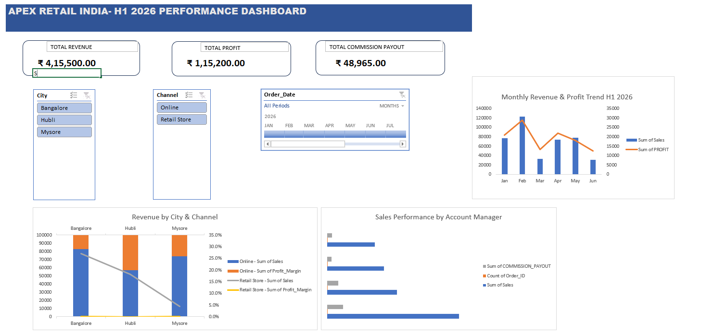
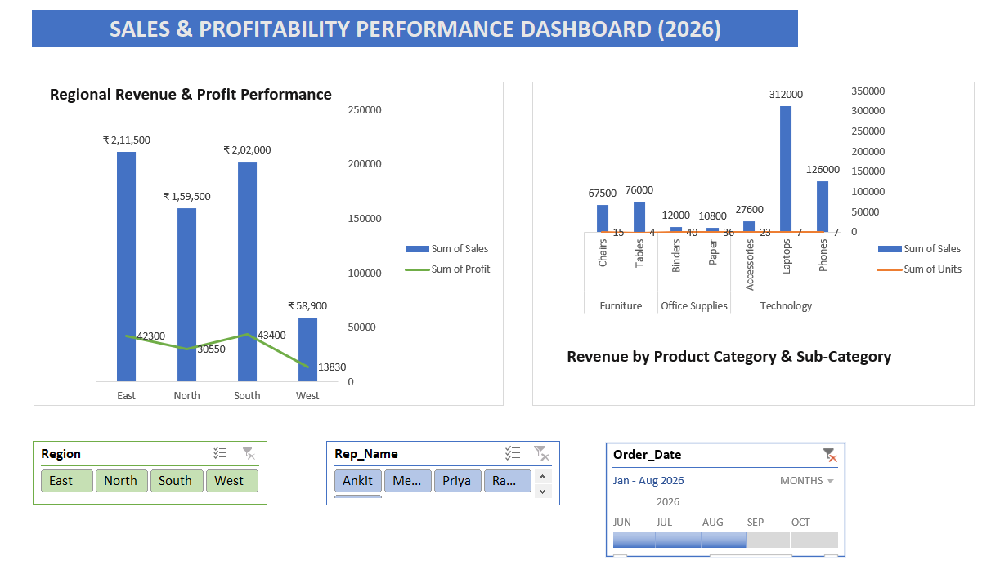

## Data-Analytics-Portfolio

End-to-end data analytics projects built with *Microsoft Excel, **SQL, **Python, and **Power BI*, focusing on data cleaning, financial modeling, relational querying, and executive dashboard design.

---

## Excel Business Intelligence Projects

### 1. Apex Retail India — H1 2026 Sales & Commission Analytics (week1_capstone_retail_analytics.xlsx)
* *Objective:* Built an end-to-end retail analytics pipeline from messy Q1–Q2 regional sales exports and commission lookup tables to evaluate channel profitability, city margins, and account manager payouts.
* *Key Techniques:*
  * Data sanitization (TRIM, CLEAN, PROPER), city standardization (Bengaluru $\rightarrow$ Bangalore), and deduplication.
  * Multi-criteria INDEX / MATCH array formulas and approximate-match VLOOKUP commission slabs inside structured Excel Tables (tbl_ApexSales).
  * Multi-dimensional Pivot Tables with custom Calculated Fields (Profit_Margin = Profit / Sales).
  * Interactive Executive Dashboard featuring dynamic KPI Cards, synced Slicers & Timeline (Report Connections), and multi-axis Combo Charts.
* *Key Findings:*
  * *#1 Account Manager:* Aarav generated *₹1,79,000* across 4 Online orders, leading all managers in total revenue.
  * *Highest Margin City:* Bangalore achieved the highest overall profit margin at *33.4%* (₹54,400 profit on ₹1,63,000 revenue), outperforming Mysore (27.5%) and Hubli (21.8%).

---

### 2. Regional Sales & Profitability Performance Dashboard (Data_Analytics_day_6_Dashboard.xlsx)
* *Objective:* Designed an interactive regional and category performance dashboard tracking revenue, profit, and unit volume across sales representatives and order dates.
* *Key Techniques:*
  * Structured Pivot Table backbone powering dynamic KPI summary cards, regional combo charts, and category breakdowns.
  * Cross-filtered Slicers (Region, Rep_Name) and Order_Date Timeline for real-time executive drill-downs.

 Data-Analytics-Portfolio
